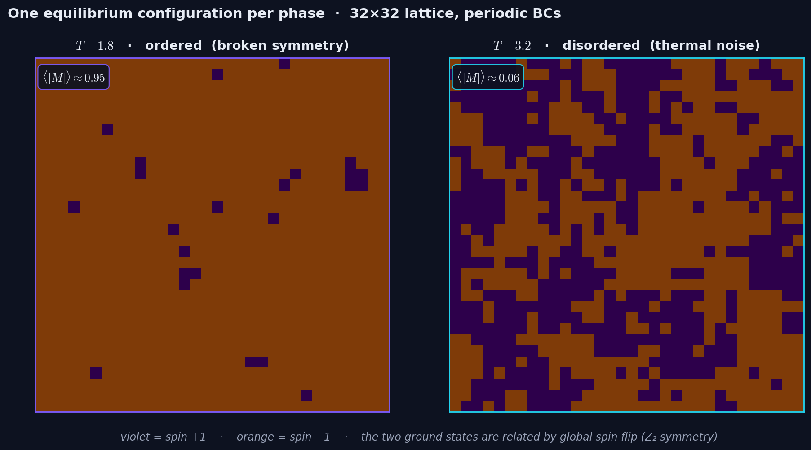
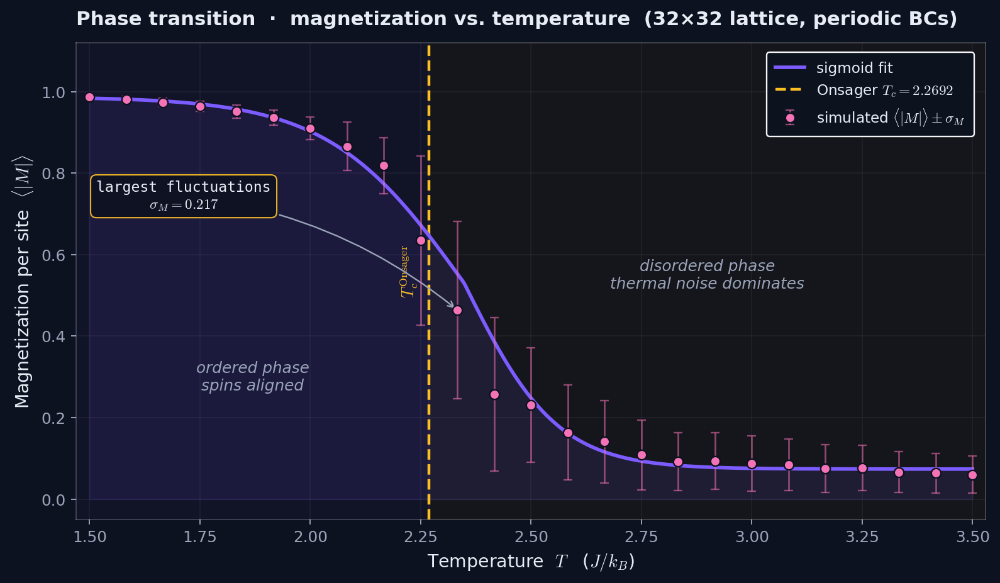
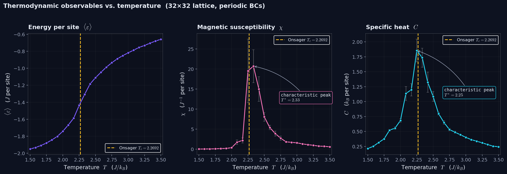
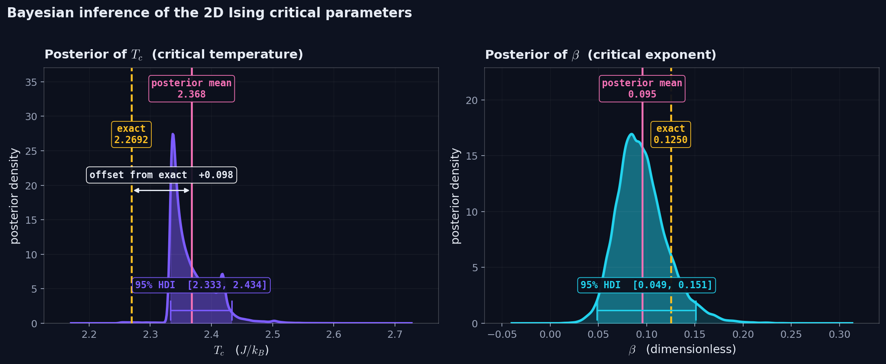
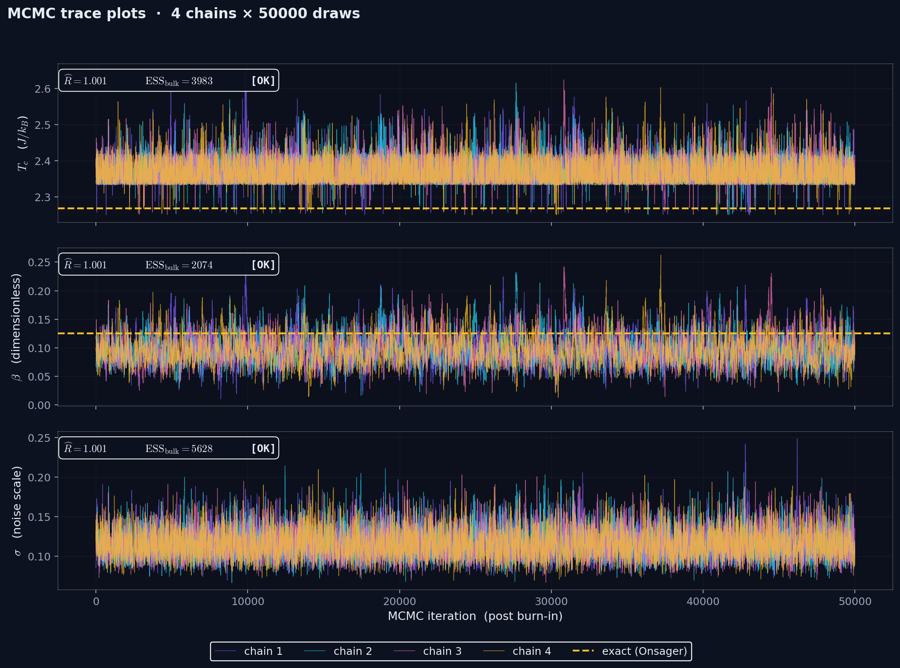
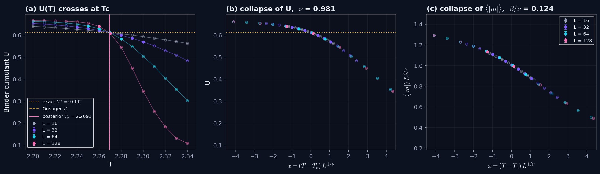

# Bayesian inference on the 2D Ising model

[](https://github.com/crozol/01-ising-bayesian/actions/workflows/tests.yml)
[](https://opensource.org/licenses/MIT)
[](https://crozol.github.io/projects/01-ising-bayesian.html)
[](https://huggingface.co/spaces/crozol/ising-bayesian-demo)

**TL;DR** — Bayesian inference of the 2D Ising critical point from Metropolis Monte Carlo data. A finite-size-scaling fit of the Binder cumulant and the magnetisation for L = 16, 32, 64 gives `Tc = 2.268` (95% HDI `[2.265, 2.271]`; Onsager `2.2692`), `ν = 0.98 [0.92, 1.05]` (exact `1`) and `β = 0.113 [0.101, 0.126]` (exact `1/8`), with flat priors on all three. These HDIs are statistical only: refits with other lattice sizes and temperature windows move `ν` over `0.95–1.39` and `β` over `0.088–0.146` (Section 12). A first fit of a pure power law to a single lattice (L = 32) gives `Tc = 2.37` and a `β` near `1/8` only through two compensating errors: on the ordered side the simulation matches Onsager's exact magnetisation, but the power law is only its leading term; adding the first correction of Onsager's expansion, the same data give `β = 0.124 [0.122, 0.127]` (Section 11). Stack: NumPy · Numba JIT · ArviZ (PyMC 5 optional).

A numerical experiment: simulate a grid of interacting magnetic spins, observe
how its macroscopic state changes with temperature, and then try to recover the
two numbers that govern that transition — the critical temperature `Tc` and the
critical exponent `β` — from the noisy simulated data using Bayesian inference.
Both numbers are known exactly for this system (Onsager, 1944), so the
experiment has an unambiguous reference to validate against.

The document walks through the measurement and the analysis in the order you
would actually perform them, without spoiling the outcome up front. Following
along produces a physical intuition for the phase transition and a clean
probabilistic estimate of its parameters.

---

## Contents

1. [Objective](#1--objective)
2. [Equipment (software stack)](#2--equipment-software-stack)
3. [Background: what is the 2D Ising model?](#3--background-what-is-the-2d-ising-model)
4. [The observable: magnetization per site](#4--the-observable-magnetization-per-site)
5. [Procedure](#5--procedure)
   - [5.1 · The Monte Carlo "thermometer"](#51--the-monte-carlo-thermometer)
   - [5.2 · Running the system at a fixed temperature](#52--running-the-system-at-a-fixed-temperature)
   - [5.3 · Sweeping across temperatures](#53--sweeping-across-temperatures)
6. [First observation: what does the M(T) curve look like?](#6--first-observation-what-does-the-mt-curve-look-like)
7. [Energy, susceptibility and specific heat](#7--energy-susceptibility-and-specific-heat)
8. [Quantitative analysis: Bayesian inference of Tc and β](#8--quantitative-analysis-bayesian-inference-of-tc-and-β)
9. [Reading the posteriors](#9--reading-the-posteriors)
10. [MCMC diagnostics — did the sampler actually work?](#10--mcmc-diagnostics--did-the-sampler-actually-work)
11. [Is the single-size fit right?](#11--is-the-single-size-fit-right)
12. [Finite-size scaling: several lattice sizes](#12--finite-size-scaling-several-lattice-sizes)
13. [Comparison with Onsager's exact solution](#13--comparison-with-onsagers-exact-solution)
14. [Reproducing the experiment](#14--reproducing-the-experiment)
15. [Possible extensions](#15--possible-extensions)
16. [File map](#16--file-map)
17. [References](#17--references)

---

## 1 · Objective

Measure the magnetization curve `⟨|M|⟩(T)` of a 2D Ising system on a finite
lattice, and from that curve alone — treated as *experimental* data with
statistical noise — infer:

- the temperature `Tc` at which the system changes phase, and
- the exponent `β` that governs how the magnetization vanishes near `Tc`.

Report each quantity as a full **posterior distribution**, not a single point
estimate. Then compare to the exact values derived analytically for an
infinite lattice — and, when a single lattice turns out not to be enough,
repeat the inference with several lattice sizes (finite-size scaling).

## 2 · Equipment (software stack)

| Component | What it does in this experiment |
|---|---|
| Python 3.11+, NumPy | Array arithmetic and base numerics |
| Numba (`@njit`) | JIT-compiles the Metropolis inner loop (~50× speed-up) |
| SciPy (`curve_fit`) | Smooth phenomenological curve drawn through the `M(T)` data in the figure |
| NumPy MCMC samplers | Random-walk Metropolis-Hastings (single size) and adaptive Metropolis (finite-size scaling) |
| ArviZ | Posterior summaries, HDIs, `R̂`, ESS |
| PyMC 5 (optional) | Alternative NUTS backend for the single-size fit |
| Matplotlib | Static figures |

No GPU is needed. The single-size pipeline runs in under a minute on a laptop;
the finite-size-scaling simulation takes about ten minutes, dominated by the
64×64 lattice.

## 3 · Background: what is the 2D Ising model?

Picture a flat square grid, `N` sites on a side, with periodic boundaries so
that the left edge connects to the right edge and the top connects to the
bottom (a torus). At each site there is a small magnet — a **spin** —
constrained to point either up (`+1`) or down (`−1`). Neighboring spins prefer
to align: the energy cost of any configuration `s` is

```
E(s) = −J · Σ⟨i,j⟩ sᵢ sⱼ
```

where the sum runs over nearest-neighbor pairs and `J > 0` is the interaction
strength. In this project we set `J = 1` and measure temperature in the same
units (so `T` is dimensionless, in units of `J/k_B`).

The system is in contact with a thermal bath at temperature `T`. At thermal
equilibrium the probability of observing a configuration `s` follows the
Boltzmann distribution:

```
P(s) ∝ exp(−E(s) / T)
```

Two extremes are easy to reason about:

- **Low `T`**: the Boltzmann factor punishes high-energy configurations
  strongly, so the system lives near the energy minimum. The minimum has all
  spins pointing the same way — there are two such ground states, all-up and
  all-down, and the system picks one. The lattice is **magnetized**.
- **High `T`**: the Boltzmann factor is nearly flat, and thermal noise wins
  over the interaction. Spins are essentially independent coin flips. The net
  magnetization averages to zero.

The question this experiment asks is: *what happens in between?* Does the
magnetization decrease smoothly with `T`, or does it collapse suddenly at some
special temperature? That question is exactly what we are going to measure.

Before any curve, a picture of what the two regimes look like on the lattice.
One equilibrium configuration below and one above what will turn out to be
the critical temperature:



Both panels are `32×32` lattices sampled after `2500` Metropolis sweeps from
a random initial condition. Left: almost all spins point the same way; the
mean magnetization is close to `1`. Right: both orientations are present in
roughly equal areas; the mean magnetization fluctuates around `0`. The
transition between these two regimes is what the rest of this experiment
characterizes quantitatively.

## 4 · The observable: magnetization per site

The natural macroscopic quantity is the **average spin**, normalized by the
number of sites:

```
M(s) = (1 / N²) · Σᵢⱼ sᵢⱼ
```

`M` ranges from `−1` (all down) to `+1` (all up) and is `0` for a perfectly
random configuration.

Because the Hamiltonian is symmetric under flipping every spin, a finite
system at low temperature spends roughly half its time in the all-up-ish
region and half in the all-down-ish region. If we averaged `M` directly we
would get something close to `0` even at very low `T`. The physically
meaningful quantity is therefore the **absolute value**:

```
⟨|M|⟩   =   average of |M(s)| over many equilibrium configurations
```

This is the single number we will record per temperature.

## 5 · Procedure

### 5.1 · The Monte Carlo "thermometer"

We do not have an actual thermal bath. Instead we simulate one with the
**Metropolis algorithm** — a simple Markov chain that samples configurations
from the Boltzmann distribution.

One iteration (`src/metropolis.py:_sweep`):

1. Pick a random site `(i, j)`.
2. Compute the energy change `ΔE = 2·J·sᵢⱼ · (sum of the 4 neighbors)`
   that would result from flipping `sᵢⱼ`.
3. Accept the flip with probability `min(1, exp(−ΔE / T))`.

A **sweep** is `N²` single-site proposals, so on average every site is
touched once. Each run starts from a cold (fully ordered) configuration: a
random start can trap the low-temperature runs in a long-lived domain-wall
state, whereas the ordered start samples the broken-symmetry phase cleanly and
disorders just as readily above `Tc`. We do `n_therm = 2000` sweeps of burn-in
to reach equilibrium, followed by `n_measure = 3000` sweeps during which we
record the magnetization and energy after each sweep.

The hot inner loop is JIT-compiled with `@numba.njit(cache=True)`. A pure-Python
fallback activates automatically if Numba is not installed.

### 5.2 · Running the system at a fixed temperature

Before sweeping across temperatures it helps to think about what we
*expect* to see at a single `T`:

- At `T = 1.5` (very cold) the chain should quickly fall into an all-aligned
  state and stay there. The recorded `|M|` values should cluster near `1`
  with very small variance.
- At `T = 3.5` (very hot) the chain should wander across roughly equally
  probable configurations with no preferred direction. Individual `|M|`
  samples should still be positive (we took the absolute value), but small
  and noisy — on the order of `1/N` because it is the typical size of a
  finite-sum fluctuation.
- Somewhere in the middle, something interesting must happen to connect
  these two regimes. We do not assume *where* — we measure it.

### 5.3 · Sweeping across temperatures

`src/metropolis.py:run_full_simulation` runs the procedure above at `25`
temperatures spaced evenly in `T ∈ [1.5, 3.5]`, which brackets both
extremes, and writes the result to `data/magnetization.csv`:

| column | meaning |
|---|---|
| `T` | temperature (units of `J/k_B`) |
| `M_mean` | sample mean of `|M|` over the `n_measure` equilibrium sweeps |
| `M_std` | sample standard deviation of `|M|` over the same sweeps |
| `M_err` | standard error of `⟨|M|⟩`, by blocking |
| `E_mean`, `E_err` | mean energy per site and its blocking error |
| `chi`, `chi_err` | magnetic susceptibility and its block-jackknife error |
| `C`, `C_err` | specific heat and its block-jackknife error |

`M_std` and `M_err` answer different questions. `M_std` is the width of the
distribution of `|M|` at that temperature — how much the magnetisation
fluctuates from sweep to sweep, a physical quantity that peaks at the
transition. `M_err` is the uncertainty of the *average* `⟨|M|⟩`, estimated by
blocking so that the autocorrelation of consecutive sweeps is accounted for;
it is what the likelihood in Section 8 uses. The remaining columns are the
thermodynamic observables analysed in Section 7.

Nothing about Onsager's solution is used at any point here. The simulator
is blind to the theoretical answer.

## 6 · First observation: what does the M(T) curve look like?

Before looking at the figure, try to predict it. A smooth interpolation
between `⟨|M|⟩ ≈ 1` at cold and `⟨|M|⟩ ≈ 0` at hot is the minimum that
physics demands. Does the decline happen linearly? Gently? Abruptly? At
what `T`?

Now the data:



Three features are worth naming out loud before moving on:

1. **Two plateaus.** `⟨|M|⟩` saturates near `1` for `T ≲ 2` and near `0` for
   `T ≳ 2.7`. The behavior in those regions is dull and not very
   informative — the magnetization is not changing.
2. **A sharp drop between ~2.2 and ~2.5.** Something dramatic is happening
   in a narrow window. The curve is not a slow roll; the system changes
   character over a range of roughly `0.2` units of `T`. This is the
   signature of a **phase transition**.
3. **Fluctuations grow dramatically around the drop.** At `T ≈ 2.33` the
   standard deviation across sweeps is `0.22` — the equilibrium
   configuration is no longer a single well-defined state but a fluctuating
   mixture. These are the critical fluctuations that give phase transitions
   their reputation for being numerically delicate.

At this point we can *guess* that the critical temperature sits somewhere
between `2.25` and `2.45`. But "somewhere" is not an estimate; we want a
number with a credible interval. That is what the Bayesian analysis below
delivers. First, though, three more observables give an independent look at the
same transition.

## 7 · Energy, susceptibility and specific heat

The magnetization is the order parameter, but it is not the only quantity that
feels the transition. Three companion observables, all measured from the *same*
equilibrium configurations, give independent views of the same critical point:

- the **energy per site** `⟨ε⟩ = ⟨E⟩/N²`, counting how many neighbour bonds are
  satisfied;
- the **magnetic susceptibility** `χ = (N²/T)·(⟨m²⟩ − ⟨|m|⟩²)`, the variance of
  the magnetization;
- the **specific heat** `C = (N²/T²)·(⟨ε²⟩ − ⟨ε⟩²)`, the variance of the energy.

The last two are fluctuation observables: by the fluctuation–dissipation
relation they measure the system's response — to a magnetic field and to
heating — and both are expected to peak at the transition.



**Energy.** `⟨ε⟩` climbs smoothly from the ground-state value `−2J` (every bond
satisfied) toward `0`, with its steepest slope in the critical region. Its error
bars — the statistical error of the mean, estimated by blocking — are tiny: a
mean is an easy thing to measure well.

**Susceptibility and specific heat.** Both peak in the critical region: `χ` at
`T = 2.33` and `C` at `T = 2.25`, the grid points nearest the transition on
either side of Onsager's infinite-lattice `Tc = 2.2692`. On a finite lattice
these peaks are *pseudo-critical* temperatures, displaced from `Tc` by an
amount that shrinks as `L^(−1/ν)`; with a grid spacing of `0.083` this sweep
can only place them to within a grid step. Section 12 locates `Tc` precisely
with several lattice sizes.

**Why the peaks are ragged.** Unlike the energy, `χ` and `C` carry large, unequal
error bars near the transition, and `χ` even shows a spurious secondary bump
around `T ≈ 2.17`. This is not a second transition — it is *critical slowing
down*. Near `Tc` the correlation length grows to the size of the lattice and the
autocorrelation time of single-spin-flip Metropolis dynamics diverges as
`τ ∝ ξ^z`, with a dynamic exponent `z ≈ 2.17` for the 2D Ising model
(Hohenberg & Halperin 1977; Nightingale & Blöte 1996). The chain decorrelates so
slowly there that a fixed-length run holds only a handful of independent samples,
so variance-based estimators like `χ` and `C` turn noisy — which is exactly why
their error bars balloon in the critical region while `⟨ε⟩` stays clean. The
block-jackknife bars (Newman & Barkema 1999) make this honest: the secondary bump
sits well within its own uncertainty. The standard cure is a cluster algorithm
(Swendsen–Wang 1987; Wolff 1989), which updates whole correlated domains at
once — a natural extension, not used here.

## 8 · Quantitative analysis: Bayesian inference of Tc and β

Close to a second-order phase transition, statistical mechanics predicts that
the order parameter vanishes as a power law of the reduced temperature:

```
⟨|M|⟩(T)   ≈   (1 − T/Tc)^β        if T < Tc
⟨|M|⟩(T)   =   0                     if T > Tc
```

`β` is called a **critical exponent**, and for the 2D Ising universality class
theory predicts `β = 1/8` exactly. `Tc` is the critical temperature itself.

### Setting up the probabilistic model

The simulated data `{T_k, M_k, e_k}` (with `e_k` the standard error `M_err`)
are treated as noisy observations of that piecewise power law. The
probabilistic model (`src/bayesian.py`) is:

**Priors** — what we believe about the parameters *before* seeing the data:

| Parameter | Prior | Why |
|---|---|---|
| `Tc` | `Normal(2.3, 0.3)` | broad envelope over the whole transition region |
| `β`  | `Uniform(0.01, 0.5)` | flat, so that no knowledge of the exact `1/8` enters through the prior |
| `σ`  | `HalfNormal(0.1)` | scale of what the power law does not describe |

An earlier version used `β ~ Normal(0.12, 0.05)`, centred almost on the exact
value; a posterior that "recovers" `1/8` under such a prior is partly the
prior speaking. Section 11 compares both.

**Likelihood** — Gaussian, with a variance per point:

```
M_k  ~  Normal( (1 − T_k/Tc)^β ,  √(e_k² + σ²) )      if T_k < Tc
M_k  ~  Normal( 0              ,  √(e_k² + σ²) )      otherwise
```

`e_k` is the Monte Carlo error of each point, known from the simulation; `σ`
is a free *discrepancy* term that absorbs whatever the power law does not
describe. If the model were exact, `σ` would come out close to zero.

**Posterior** — by Bayes' theorem:

```
P(Tc, β, σ | data)   ∝   P(data | Tc, β, σ) · P(Tc, β, σ)
```

There is one more modelling choice here, and it matters: the mean is a pure
power law with amplitude fixed to `1`, and it is zero above `Tc`. On a finite
lattice `⟨|M|⟩` is not zero above `Tc` (it decays like `1/L`), and below `Tc`
the power law is only the leading term of the exact magnetisation. Section 11
tests what these simplifications do to the result.

The left-hand side has no closed form; we sample from it with MCMC.

### Sampling the posterior

Two backends are shipped, both producing an `arviz.InferenceData` so the
downstream figures are backend-agnostic:

- **`numpy` (default)** — a random-walk Metropolis-Hastings sampler
  implemented directly on the log-posterior. No C compiler required; runs in
  about 15 seconds. 4 chains × (1000 tune + 50 000 draws).
- **`pymc`** — reference implementation with PyMC + NUTS (gradient-based).
  More efficient but relies on PyTensor's C backend.

Select with `--backend numpy|pymc`.

## 9 · Reading the posteriors



**Left panel · posterior of `Tc`.** Most of the probability mass lies between
`2.33` and `2.43`, with a sharp peak near `2.34` and a long tail to higher
temperatures. The pink vertical line is the posterior mean (`2.368`); the
orange dashed line is Onsager's exact value `Tc = 2.2692`; the bar is the 95%
highest-density interval (HDI). The exact value falls **outside** the HDI, by
about `0.1`.

The asymmetric shape is a feature of the likelihood: the piecewise mean has
a hard threshold at `T = Tc`, so as `Tc` slides across a data temperature the
number of points in the power-law arm changes by one, producing kinks in the
log-posterior.

**Right panel · posterior of `β`.** The posterior is wide — the 95% HDI
`[0.049, 0.151]` spans a factor of three — and the exact `1/8` sits inside it,
toward the upper end. A credible interval this wide is not much of a
measurement, and Section 11 shows that its location depends on modelling
choices more than on the data.

The posterior of the discrepancy term, `σ = 0.115 [0.083, 0.151]`, is the
first warning: it is about a hundred times larger than the Monte Carlo
errors `e_k` (`10⁻⁴` to `4 × 10⁻²`). The power law misses the data by far more
than the data's own uncertainty.

## 10 · MCMC diagnostics — did the sampler actually work?

A sampler that has not converged produces numbers that look like samples
but are not. These three checks are non-negotiable:



- **`R̂` (Gelman-Rubin).** Compares variance between chains to variance within
  chains. `R̂ ≤ 1.01` is the gold standard, `≤ 1.05` is tolerable. Here
  `R̂ = 1.00` for all three parameters.
- **`ESS_bulk` (effective sample size).** Accounts for autocorrelation —
  one independent sample is worth many correlated ones. `≥ 200` is a
  working threshold. All three clear it: `Tc` 3 983, `σ` 5 628 and `β` 2 074.
  The hard threshold at `T = Tc` makes `β` the slowest-mixing parameter of
  this random-walk sampler, which is why the chains are 50 000 draws long:
  with 5 000, the ESS of `β` was 187.
- **Visual inspection.** Healthy chains overlap, do not drift with
  iteration, do not stick in any one region. Each subplot above shows all
  four chains on top of each other.

The acceptance rate is 29–31% per chain. The sampler explores this posterior
adequately, with `β` the parameter to watch. Convergence, though, only says
the posterior was sampled correctly — not that the model behind it is right.

## 11 · Is the single-size fit right?

The single-size fit leaves `Tc` about `0.1` above the exact value and `β`
poorly constrained, with a discrepancy term far larger than the data's own
errors. `scripts/model_comparison.py` refits the same data under each
combination of three choices — fitting all temperatures or only the ordered
side `T < 2.25` (away from the rounded transition and the `1/L` tail above
it), a homoscedastic or heteroscedastic likelihood, and the normal or the flat
prior on `β`:

| Fit window | Likelihood | `β` prior | `Tc` | `β` (95% HDI) | `σ` |
|---|---|---|---|---|---|
| all `T` | homoscedastic | normal | 2.370 ± 0.036 | 0.102 [0.057, 0.150] | 0.119 |
| all `T` | homoscedastic | flat | 2.368 ± 0.037 | 0.099 [0.052, 0.154] | 0.119 |
| all `T` | heteroscedastic | normal | 2.369 ± 0.035 | 0.098 [0.056, 0.145] | 0.115 |
| all `T` | heteroscedastic | flat (**used**) | 2.368 ± 0.036 | 0.095 [0.049, 0.151] | 0.115 |
| `T < 2.25` | homoscedastic | normal | 2.31 ± 0.19 | 0.046 [0.025, 0.080] | 0.035 |
| `T < 2.25` | homoscedastic | flat | 2.26 ± 0.14 | 0.041 [0.024, 0.067] | 0.032 |
| `T < 2.25` | heteroscedastic | normal | 2.31 ± 0.18 | 0.046 [0.025, 0.079] | 0.034 |
| `T < 2.25` | heteroscedastic | flat | 2.25 ± 0.13 | 0.040 [0.024, 0.065] | 0.031 |

Three things follow.

1. **The likelihood and the prior barely matter.** The heteroscedastic
   likelihood cannot help when `σ` dominates every `e_k`, and the flat prior
   moves `β` by less than its own uncertainty.
2. **The fit window matters a great deal.** On the ordered side alone, `β`
   drops to `0.04` and its HDI excludes `1/8`, while `Tc` is barely
   constrained (`± 0.13` to `± 0.19`).
3. **The simulation is not the problem.** For `T < 2.25` the measured
   `⟨|M|⟩` agrees with Onsager's exact infinite-lattice magnetisation
   `M(T) = (1 − sinh(2/T)⁻⁴)^(1/8)` (Yang 1952) to within `0.012`, or 1.8
   standard errors. The pure power law with the *exact* `Tc` and `β` misses the
   same points by up to `0.14`: it is only the leading term of `M(T)` as
   `T → Tc`, with an amplitude of about `1.22` rather than `1`.

Freeing the amplitude, `M = B (1 − T/Tc)^β`, does not rescue the fit: on the
ordered side it gives `β = 0.074 [0.055, 0.103]`, which excludes `1/8`, and over
the full range `β = 0.38`, far from it.

Fixing the amplitude at its exact value does not rescue it either, and the
way it fails shows what is missing. To leading order in `t = 1 − T/Tc`,
Onsager's magnetisation is `M ≈ A t^(1/8)` with `A = (8√2/Tc)^(1/8) = 1.2224`.
With `A`, `Tc` and `β` all exact, that leading term still misses the exact
curve by up to `0.081` on `T ∈ [1.5, Tc)` (`0.146` with `A = 1`); at `t = 0.3`
the exact `M` lies 7% below it. The ordered-side data sit at `t` between
`0.01` and `0.34`, where the next term of the expansion is not negligible, and
a fit without that term compensates with the only exponent it has: `β` rises
to `0.19–0.23` across the four fixed-amplitude fits (both windows, both
priors), and every HDI excludes `1/8`.

The fix is to include that term. To first order,
`M_Onsager / (A t^(1/8)) = 1 + b t + O(t²)` with `b = −0.225`, and on `T < 2.25`
the `O(t²)` remainder is at most `0.97` Monte Carlo standard errors at any data
point. The model `M = A t^β (1 + b t)` therefore needs no discrepancy term `σ`:
the likelihood uses the Monte Carlo errors alone, with flat priors on `Tc`,
`β` and `b`. On the same nine points as above it gives `β = 0.124 [0.122, 0.127]`,
`Tc = 2.262 [2.244, 2.281]` and `b = −0.227 [−0.233, −0.221]`, with
`χ² = 8.1` for 6 degrees of freedom: all three compatible with the exact
`1/8`, `2.269` and `−0.225`. On `T < 2.1` (eight points) the result is the
same (`β = 0.124`, `Tc = 2.260`).

This is a consistency check, not an independent measurement: `A` and the form
of the correction come from the exact solution, which a measurement on an
unsolved model would not have. What it establishes is that the single-size
data are right and that the failures above come from the functional form.
The estimate that uses no exact input is the finite-size scaling of
Section 12.

The conclusion is that a single lattice cannot determine `β` from the leading
power law alone. Close to `Tc`, where that power law holds, the finite lattice
rounds the transition and leaves a `1/L` tail; far from `Tc`, where the
lattice behaves like an infinite one, the leading term is not enough and the
correction above is needed. The `β ≈ 0.09–0.10` of the
full-range fit is a compromise between those two errors, and its proximity to
`1/8` is partly luck. The `+0.1` offset in `Tc` is a finite-size effect only
in that the `1/L` tail above `Tc` exists because the lattice is finite. It is
not a shift of the transition: the Binder cumulants of `L = 32` and `L = 64`
cross at `2.264 ± 0.005`, compatible with the exact `Tc` (Section 12). The
offset comes from the model, which sets `M = 0` above `Tc` and cannot describe
that tail; the fitted threshold moves up to absorb it.

## 12 · Finite-size scaling: several lattice sizes

The finite lattice is not just a nuisance; how the observables change with
`L` carries the critical behaviour (Fisher & Barber 1972). Near `Tc` they
depend on `T` and `L` only through the scaling variable
`x = (T − Tc) · L^(1/ν)`, up to corrections that shrink with `L`. Two
observables are used:

- the **Binder cumulant** `U = 1 − ⟨m⁴⟩ / (3⟨m²⟩²)` (Binder 1981), which is
  dimensionless, so `U(T, L) = f(x)`: the curves for different `L` cross at
  `Tc`, at a universal value `U* ≈ 0.6107` for the periodic square lattice
  (Salas & Sokal 2000);
- the **magnetisation**, `⟨|m|⟩(T, L) = L^(−β/ν) g(x)`, whose size dependence
  at `Tc` gives the ratio `β/ν`.

**Data.** `src/fss.py` runs `L = 8, 16, 32, 64` at 15 temperatures in
`[2.20, 2.34]`. Metropolis decorrelates slowly near `Tc` (Section 7), so each
point uses 20 000 burn-in and 200 000 measured sweeps — forty times the
single-size run — with errors from a 50-block jackknife.

**Model.** `src/fss_fit.py` fits both observables jointly, with `f` and `g`
expanded to second order in `x`:

```
U(T, L)      =  U* + u₁ x + u₂ x²
⟨|m|⟩(T, L)  =  L^(−β/ν) (g₀ + g₁ x + g₂ x²),       x = (T − Tc) L^(1/ν)
```

The priors are flat on `Tc ∈ (2.0, 2.6)`, `ν ∈ (0.5, 2)`, `β/ν ∈ (0, 0.5)` and
on the six expansion coefficients, so none of the exact values is encoded.
Each observable has a discrepancy term, as in Section 8. The likelihood is
linear in the six coefficients, which are integrated out analytically; the
remaining five parameters are sampled with adaptive Metropolis (Haario,
Saksman & Tamminen 2001), 4 chains × 10 000 draws, `R̂ = 1.00`, `ESS_bulk > 3 000`
for every parameter.

The fit uses `L = 16, 32, 64` and `T ∈ [2.23, 2.31]`. The smallest lattice is
left out because corrections to scaling are largest there, and the window is
the widest in which both discrepancy terms are consistent with zero, i.e. the
quadratic scaling functions describe the data within their errors. Neither
criterion uses the exact values.



Panel (a) shows the Binder curves crossing; panels (b) and (c) show that,
with the fitted `Tc`, `ν` and `β/ν`, the points from all sizes fall on a single
curve. Hollow points lie outside the fitted sizes or window.

| Parameter | Posterior mean | 95% HDI | Exact |
|---|---|---|---|
| `Tc` | **2.268** | [2.265, 2.271] | 2.2692 |
| `ν` | **0.98** | [0.92, 1.05] | 1 |
| `β = ν · (β/ν)` | **0.113** | [0.101, 0.126] | 0.125 |
| `U*` | **0.613** | [0.610, 0.616] | 0.6107 |

All four HDIs contain the exact values, `β` near the upper edge of its
interval. As a model-free check, the crossing of the Binder curves for
`L = 32` and `64` lies at `T = 2.264 ± 0.005`.

**How much do these numbers depend on the choices above?**
`scripts/fss_systematics.py` refits with other size sets and windows:

| Sizes | `T` window | `Tc` | `ν` | `β` |
|---|---|---|---|---|
| 16, 32, 64 (**used**) | [2.23, 2.31] | 2.268 [2.265, 2.271] | 0.98 [0.92, 1.05] | 0.113 [0.101, 0.126] |
| 8, 16, 32, 64 | [2.23, 2.31] | 2.268 [2.266, 2.270] | 0.95 [0.92, 0.99] | 0.112 [0.106, 0.118] |
| 16, 32, 64 | [2.20, 2.34] | 2.263 [2.258, 2.268] | 1.14 [1.07, 1.22] | 0.115 [0.102, 0.129] |
| 8, 16, 32, 64 | [2.20, 2.34] | 2.265 [2.262, 2.268] | 1.06 [1.03, 1.10] | 0.121 [0.115, 0.127] |
| 16, 32, 64 | [2.245, 2.295] | 2.268 [2.261, 2.274] | 1.25 [1.00, 1.59] | 0.146 [0.099, 0.203] |
| 32, 64 | [2.23, 2.31] | 2.255 [2.234, 2.269] | 1.39 [1.02, 1.89] | 0.088 [0.021, 0.138] |

`Tc` is stable to `±0.005` across every choice. `ν` and `β` are not: they move
by more than their statistical uncertainty, and several HDIs exclude the exact
values. That spread is the systematic error of the analysis — corrections to
scaling, the truncated expansion of `f` and `g`, and Monte Carlo errors that
the jackknife may underestimate for `L = 64`, where the autocorrelation time
near `Tc` is a few thousand sweeps. A statistical HDI from one configuration
therefore understates the real uncertainty in the exponents: across the
configurations above, `ν` ranges over `0.95–1.39` and `β` over `0.088–0.146`.

## 13 · Comparison with Onsager's exact solution

For the 2D Ising model on an *infinite* lattice, the critical parameters were
derived analytically by Onsager (1944) and Yang (1952):

```
Tc   =   2 / ln(1 + √2)   ≈   2.2692
β    =   1/8              =   0.125
ν    =   1
```

| Method | `Tc` (95% HDI) | `β` (95% HDI) | Exact in HDI? |
|---|---|---|---|
| Single lattice, `L = 32`, power law (Sections 8–11) | 2.368 [2.333, 2.434] | 0.095 [0.049, 0.151] | `Tc` no · `β` yes, but not robust |
| Finite-size scaling, `L = 16–64` (Section 12) | 2.268 [2.265, 2.271] | 0.113 [0.101, 0.126] | both yes |

The single-size fit is not a usable estimator of either quantity: its `Tc` is
off by `+0.1`, and its `β` interval is wide and moves with the fit window.
Finite-size scaling recovers `Tc` to within `0.001` and `β` to within its
uncertainty, using the same simulator and the same kind of Bayesian model —
the difference is that it models how the finite lattice distorts the
transition instead of ignoring it.

## 14 · Reproducing the experiment

```bash
pip install -r requirements.txt

# Option A — full pipeline end-to-end (about 11 minutes)
python main.py
python main.py --reuse-fss      # skip the finite-size-scaling simulation if data/fss.csv exists

# Option B — step by step
python -m src.metropolis --out data/magnetization.csv --size 32 --n-temps 25
python -m src.bayesian   --input data/magnetization.csv --output data/trace.nc
python -m src.fss        --sizes 8 16 32 64 --out data/fss.csv
python -m src.fss_fit    --csv data/fss.csv
python -m src.plots      --csv data/magnetization.csv --trace data/trace.nc \
                         --out-dir figures --lattice-size 32

# Section 11 and Section 12 tables
python -m scripts.model_comparison --csv data/magnetization.csv
python -m scripts.fss_systematics  --csv data/fss.csv
```

Every simulation is seeded (`src/metropolis.py::_seed` seeds the RNG inside
Numba's compiled code), so these commands reproduce the numbers above exactly.

Typical runtimes on a laptop CPU:

| Stage | Time |
|---|---|
| Single-size simulation (32×32, 25 temperatures) | ~10 s |
| Single-size MCMC (4 chains × 50 000 draws) | about 15 s |
| Finite-size-scaling simulation (L = 8–64, 15 temperatures) | ~10 min |
| Finite-size-scaling fit | ~15 s |
| Figures | < 5 s |

A companion notebook `notebooks/explore.ipynb` steps through the single-size
pipeline interactively with intermediate prints.

## 15 · Possible extensions

**A cluster algorithm.** Swendsen–Wang or Wolff updates remove most of the
critical slowing down of Section 7, which would allow larger lattices
(`L = 128, 256`) near `Tc` at the same cost and shrink the systematic spread
of `ν` and `β` in Section 12.

**Corrections to scaling.** Adding the leading correction term `L^(−ω)` to
the scaling functions would let the fit use the small lattices without
biasing the exponents.

## 16 · File map

```
01-ising-bayesian/
├── README.md
├── requirements.txt
├── main.py                      # end-to-end pipeline
├── src/
│   ├── __init__.py
│   ├── metropolis.py            # Numba-accelerated Metropolis simulator
│   ├── bayesian.py              # single-size model: NumPy MH + PyMC backends
│   ├── fss.py                   # finite-size-scaling data: <|m|> and Binder cumulant
│   ├── fss_fit.py               # Bayesian finite-size-scaling fit
│   └── plots.py                 # static figures
├── scripts/
│   ├── model_comparison.py      # Section 11: table, Onsager check, free/fixed amplitude, correction to scaling
│   ├── fss_systematics.py       # Section 12 systematics table
│   ├── summarize.py             # posterior summary → JSON
│   └── export_json.py           # arrays → JSON for the portfolio page
├── notebooks/
│   └── explore.ipynb            # step-by-step walkthrough
├── figures/                     # tracked PNGs embedded in this README
│   ├── snapshots.png            # two equilibrium lattices, one per phase
│   ├── magnetization.png        # M(T) curve + fit + Onsager line
│   ├── observables.png          # energy, susceptibility, specific heat vs. T
│   ├── posteriors.png           # marginal posteriors of Tc and β (single size)
│   ├── trace.png                # per-chain trace plots + diagnostics
│   └── fss.png                  # Binder crossing and data collapse
├── data/                        # (gitignored) generated CSV + NetCDF
└── results/                     # (gitignored) staging for fresh PNGs
```

## 17 · References

- Onsager, L. (1944). *Crystal Statistics. I. A Two-Dimensional Model with
  an Order-Disorder Transition.* Physical Review **65**, 117.
- Metropolis, N., Rosenbluth, A. W., Rosenbluth, M. N., Teller, A. H., &
  Teller, E. (1953). *Equation of State Calculations by Fast Computing
  Machines.* Journal of Chemical Physics **21**, 1087.
- Hoffman, M. D. & Gelman, A. (2014). *The No-U-Turn Sampler.*
  Journal of Machine Learning Research **15**.
- Ferrenberg, A. M. & Landau, D. P. (1991). *Critical behavior of the
  three-dimensional Ising model: A high-resolution Monte Carlo study.*
  Physical Review B **44**, 5081.  (finite-size scaling reference)
- Hohenberg, P. C. & Halperin, B. I. (1977). *Theory of Dynamic Critical
  Phenomena.* Reviews of Modern Physics **49**, 435.  (dynamic critical
  exponents and critical slowing down)
- Nightingale, M. P. & Blöte, H. W. J. (1996). *Dynamic Exponent of the
  Two-Dimensional Ising Model and Monte Carlo Computation of the Subdominant
  Eigenvalue of the Stochastic Matrix.* Physical Review Letters **76**, 4548.
  (dynamic exponent `z ≈ 2.17`)
- Swendsen, R. H. & Wang, J.-S. (1987). *Nonuniversal Critical Dynamics in
  Monte Carlo Simulations.* Physical Review Letters **58**, 86.  (cluster
  algorithm)
- Wolff, U. (1989). *Collective Monte Carlo Updating for Spin Systems.*
  Physical Review Letters **62**, 361.  (single-cluster algorithm)
- Newman, M. E. J. & Barkema, G. T. (1999). *Monte Carlo Methods in
  Statistical Physics.* Oxford University Press.  (critical slowing down;
  blocking and jackknife error analysis)
- Gelman, A. et al. (2013). *Bayesian Data Analysis*, 3rd ed., Chapman &
  Hall.  (general reference for priors, HDIs, and diagnostics)
- Yang, C. N. (1952). *The Spontaneous Magnetization of a Two-Dimensional
  Ising Model.* Physical Review **85**, 808.  (exact magnetisation `M(T)`)
- Fisher, M. E. & Barber, M. N. (1972). *Scaling Theory for Finite-Size
  Effects in the Critical Region.* Physical Review Letters **28**, 1516.
- Binder, K. (1981). *Finite size scaling analysis of Ising model block
  distribution functions.* Zeitschrift für Physik B **43**, 119.  (Binder
  cumulant)
- Salas, J. & Sokal, A. D. (2000). *Universal Amplitude Ratios in the
  Critical Two-Dimensional Ising Model on a Torus.* Journal of Statistical
  Physics **98**, 551.  (`U* = 0.6107`)
- Haario, H., Saksman, E. & Tamminen, J. (2001). *An adaptive Metropolis
  algorithm.* Bernoulli **7**, 223.
